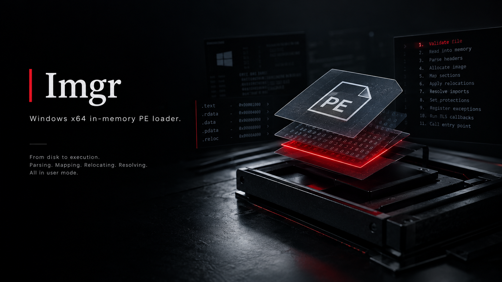

# Imgr

**Windows x64 In-Memory PE Loader**

## Overview

Imgr is an educational Windows x64 in-memory PE loader written in C. It reads a PE file from disk, maps it into a heap-allocated block, applies base relocations, resolves imports, sets per-section memory protections, registers the exception table, runs TLS callbacks, and invokes the entry point.

Imgr does not call `LoadLibrary` or any OS loader routine to load the target image itself. The mapping and loading operations are implemented in user mode using standard Win32 APIs.

The project focuses on understanding PE internals, image mapping, relocation processing, import resolution, memory protection, TLS callbacks, and x64 exception handling.

## Source Layout

```text
include/loader.h    Public types, status enum, loader context struct
include/common.h    Function prototypes shared across modules
src/main.c          CLI entry, orchestration, file validation
src/loader.c        File reading, PE parsing, image allocation, section mapping
src/reloc.c         Base relocation processing
src/iat.c           Import directory parsing and IAT patching
src/protect.c       Per-section VirtualProtect
src/entry.c         Entry point invocation with SEH wrapper
src/exceptions.c    RtlAddFunctionTable registration for x64 unwind data
src/tls.c           TLS callback execution
target/target.c     Minimal test binary that displays a MessageBox
build.bat           Build script, outputs to bin/
```

## Loading Pipeline

 1. Validate the input path and verify that the file is readable.
 2. Read the entire PE file into a heap buffer.
 3. Parse the DOS header and verify the `MZ` signature.
 4. Parse the NT headers and verify the PE signature.
 5. Validate the section table against the file boundaries.
 6. Print the section headers.
 7. Allocate `SizeOfImage` bytes using `VirtualAlloc` with `PAGE_EXECUTE_READWRITE`.
 8. Copy `SizeOfHeaders` bytes into the allocated image.
 9. Map each section by copying its raw data to the appropriate virtual address.
10. Calculate the relocation delta and apply `IMAGE_REL_BASED_DIR64` fixups.
11. Resolve imported functions by name or ordinal using `LoadLibraryA` and `GetProcAddress`.
12. Apply per-section memory protections using `VirtualProtect`.
13. Register the x64 exception directory using `RtlAddFunctionTable`.
14. Execute TLS callbacks with `DLL_PROCESS_ATTACH`.
15. Invoke the image entry point inside a structured exception handling wrapper.
16. Release the image allocation and file buffer.

## Supported Features

- PE32+ x64 executables and DLLs
- Base relocation processing using `IMAGE_REL_BASED_DIR64`
- Import resolution by name and ordinal
- Section protections derived from PE section characteristics
- x64 exception table registration through `RtlAddFunctionTable`
- TLS callback execution
- Entry point invocation with structured exception handling
- Command-line interface for loading PE files

## Limitations

The current version does not support:

- PE32 x86 images
- ARM or ARM64 images
- Forwarded exports
- Delay-loaded imports
- Bound imports
- Complete TLS data block initialization
- Resource directory handling
- Load configuration directory handling
- Manifest handling
- Anti-analysis or evasion features

## Technical Notes

### Memory Allocation

The initial image allocation uses `PAGE_EXECUTE_READWRITE`. After mapping, each section receives memory protections based on its PE section characteristics.

### Module Registration

The allocated image is not backed by a file mapping and is not automatically registered in the process loader's module list. This implementation does not attempt to conceal the image from monitoring tools.

### TLS Support

TLS callbacks are invoked, but the loader does not initialize the complete TLS data block required by every PE image.

### Exception Handling

The loader registers x64 unwind information through `RtlAddFunctionTable`. Successful execution depends on the target image's requirements and the completeness of the implemented loading process.

## Version 2 Roadmap

**Current focus:** PE loading fundamentals and loader internals.

Imgr V1 prioritizes understanding and implementing the core PE loading pipeline. It was not built with evasion as a design objective.

**V2 direction:** I plan to explore additional evasion-related techniques and expand the loader's capabilities as the project evolves. These features are planned work, not capabilities claimed by the current release.

## Build Requirements

- Windows x64
- Microsoft Visual C/C++ (MSVC) toolchain
- Windows SDK
- Command Prompt or Developer Command Prompt

## Building

Run the build script from the project root:

```bat
build.bat
```

The build output is written to:

```text
bin/
├── main.exe
└── *.obj
```

## Usage

Load a PE file using either supported command-line option:

```bat
main --pe <path-to-pe>
```

Or:

```bat
main -f <path-to-pe>
```

## Testing

The test target is a minimal executable that displays a Windows `MessageBox`.

Build the target and use it to test the loader's basic mapping and execution pipeline. Successful execution depends on the target's compatibility with the features implemented in the current version.

## Disclaimer

Imgr is intended for educational purposes, Windows internals research, and controlled security research environments.

The current implementation does not claim complete compatibility with the Windows PE loader. Unsupported PE features may prevent some executables or DLLs from loading correctly.

Use the project only on systems and binaries you are authorized to analyze.

## Copyright

Copyright © 2026 Piyusha Akash. All rights reserved.